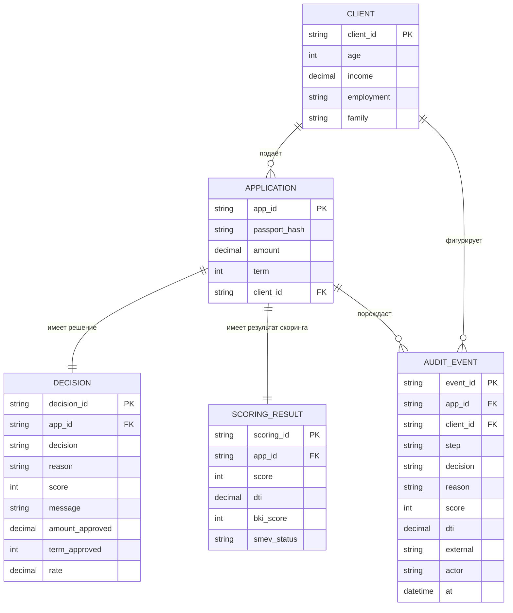

# ER-Модель

## Состав модели

`Client`, `Application`, `Decision`, `ScoringResult`, `AuditEvent`.

## Сущности и их атрибуты

### 1. Client (Клиент)
| Атрибут | Тип | Ключ |
|---|---|---|
|client_id|string|PK|
|age|integer|—|
|income|number|—|
|employment|enum|—|
|family|enum|—|
### 2. Application (Заявка)
| Атрибут | Тип | Ключ |
|---|---|---|
|app_id|string|PK|
|passport_hash|string|—|
|amount|number|—|
|term|integer|—|
|client_id|string|FK → Client.client_id|
### 3. Decision (Решение)
| Атрибут | Тип | Ключ |
|---|---|---|
|decision_id|string|PK|
|reason |enum|—|
|decision|enum|—|
|app_id|string|FK → Application.app_id|
|score|integer|—|
|message|string|—|
|amount_approved|number|— (только для APPROVED)|
|term_approved|integer|— (только для APPROVED)|
|rate|number|— (только для APPROVED)|
### 4. ScoringResult (Результат скоринга и проверок)
| Атрибут | Тип | Ключ |
|---|---|---|
|scoring_id|string|PK|
|app_id|string|FK → Application.app_id|
|score|integer|—|
|dti|number|—|
|bki_score|integer|—|
|smev_status|enum|—|
### 5. AuditEvent. (Событие аудита)
| Атрибут | Тип | Ключ |
|---|---|---|
|event_id|string|PK|
|app_id|string|FK → Application.app_id|
|client_id|string|FK → Client.client_id|
|step|enum|—|
|decision|enum|—|
|reason|enum|—|
|score|integer|—|
|dti|number|—|
|external|string(JSON)|—|
|actor|string|—|
|at|datetime|—|

*Ограничения каждого атрибута можно посмотреть в `data_dictionary`.md. Атрибуты `decision_id` и `scoring_id` создаётся автоматически и в разработке не используются.*

| Обозначение | Значение |
|---|---|
| `PK` | первичный ключ (primary key) |
| `FK` | внешний ключ (foreign key) |

## Связи

| Связь | Кардинальность | Смысл |
|---|---|---|
| Client → Application | 1 : N | один клиент может подать несколько заявок |
| Application → Decision | 1 : 1 | у заявки ровно одно итоговое решение |
| Application → ScoringResult | 1 : 1 | у заявки ровно один результат скоринга |
| Application → AuditEvent | 1 : N | по заявке пишется много событий аудита |
| Client → AuditEvent | 1 : N | события аудита ссылаются на клиента |

