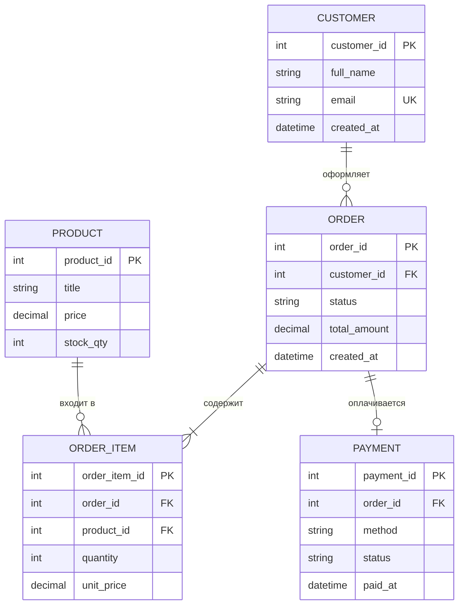

# Пример ER-диаграммы (учебный, не про проект)

## Диаграмма (Mermaid)



## Как это читать

| Обозначение | Значение |
|---|---|
| `PK` | первичный ключ (primary key) |
| `FK` | внешний ключ (foreign key) |
| `UK` | уникальное значение (unique key) |
| `||--o{` | один-ко-многим: у одного заказа много позиций |
| `||--|{` | один-ко-многим, обязательная связь (минимум одна позиция) |
| `||--o|` | один-к-одному или нулю (заказ может быть не оплачен) |

## Тот же пример словами

- **CUSTOMER** — покупатель. Один покупатель может оформить много заказов.
- **ORDER** — заказ. Принадлежит одному покупателю, состоит из одной или нескольких позиций.
- **PRODUCT** — товар. Может входить во многие позиции разных заказов.
- **ORDER_ITEM** — позиция заказа (связующая таблица между заказом и товаром).
- **PAYMENT** — оплата. У заказа может быть один платёж или ни одного.

## Вариант без Mermaid (если редактор не поддерживает)

```text
CUSTOMER (customer_id PK, full_name, email UK, created_at)
   │ 1
   │
   │ N
ORDER (order_id PK, customer_id FK, status, total_amount, created_at)
   │ 1                │ 1
   │                  │
   │ N                │ 0..1
ORDER_ITEM (...)   PAYMENT (payment_id PK, order_id FK, method, status, paid_at)
   │ N
   │
   │ 1
PRODUCT (product_id PK, title, price, stock_qty)
```
